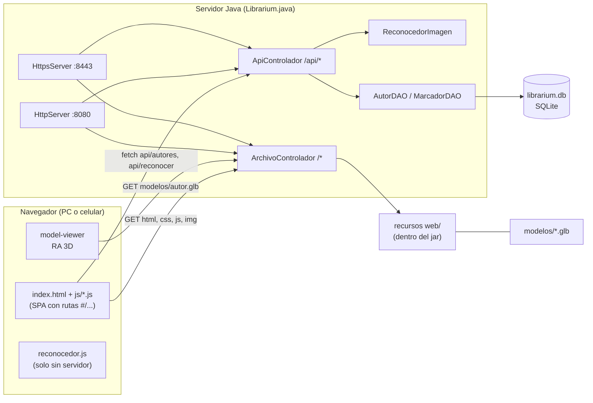
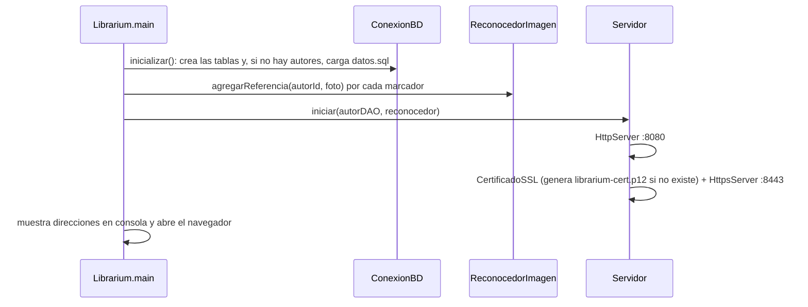
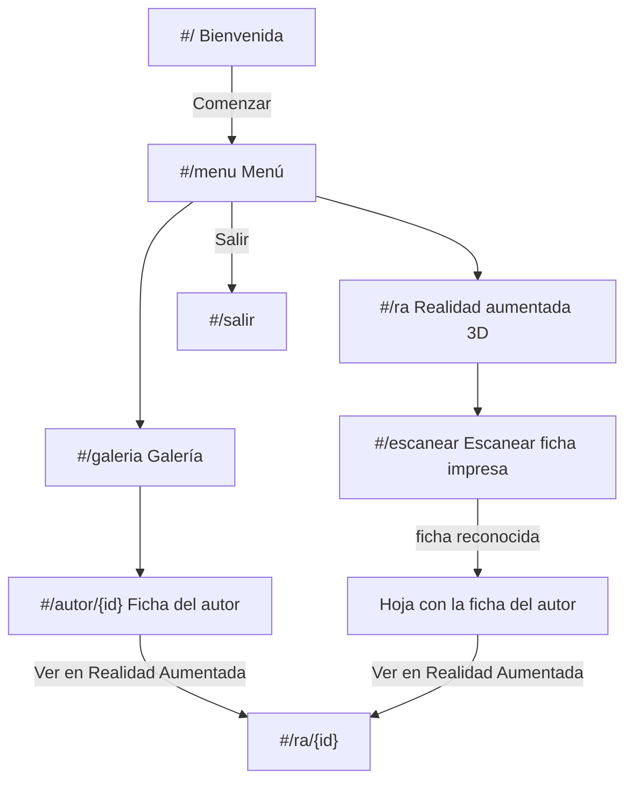
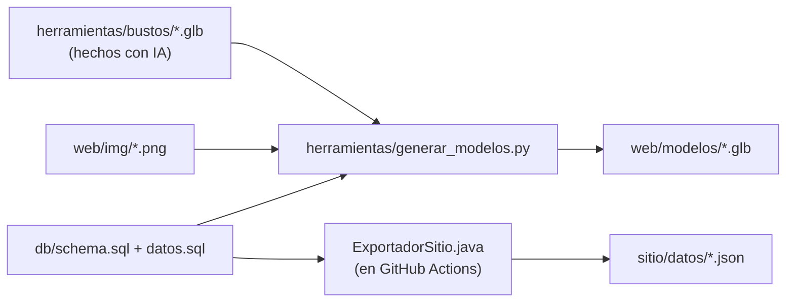

# Arquitectura

## Visión general

La aplicación es una **página única** (SPA) que habla con una **API REST** chica. El servidor Java sirve las dos
cosas: los archivos de la página y la API.

## Los dos modos de ejecución

La misma página funciona de dos formas, y **se da cuenta sola** de en cuál está
(ver [`js/api.js`](../src/main/resources/web/js/api.js)):

| | Con servidor Java | Sitio estático (GitHub Pages) |
|---|---|---|
| Cómo se usa | `java -jar librarium.jar` en una PC; el celular entra por WiFi | https://julibentz09-sketch.github.io/Librarium/ |
| Datos de autores | `GET /api/autores` (desde SQLite) | `datos/autores.json` (generado por `ExportadorSitio`) |
| Reconocimiento de fichas | `POST /api/reconocer` → `ReconocedorImagen.java` (OpenCV para Java) | En el navegador con `js/reconocedor.js` (OpenCV.js) |
| HTTPS para la cámara | Puerto 8443 con certificado autofirmado | Lo da GitHub Pages |
| QR para el celular | Muestra la IP local (`/api/info`) | Muestra la misma URL publicada |

**Cómo detecta el modo:** `obtenerAutores()` intenta `api/autores`; si falla (no hay servidor), activa la
bandera `sinServidor` y usa los JSON estáticos. Todas las funciones siguientes de `api.js` miran esa bandera.

> El algoritmo de reconocimiento existe **dos veces**: en Java y en JavaScript. Tienen que dar el mismo
> resultado. Si cambiás uno, cambiá el otro (mismas constantes y mismos pasos).

## Arranque del servidor

Archivos que crea el servidor en la **carpeta desde donde se ejecuta** (están en `.gitignore`):

- `librarium.db`: la base SQLite. Solo se cargan los datos iniciales si la tabla `autor` está vacía.
- `librarium-cert.p12`: el certificado HTTPS autofirmado, generado con `keytool` del JDK.

## Flujo de la interfaz

## Generación de contenido (fuera de la app)

Hay contenido que **no se genera en tiempo de ejecución** sino con herramientas, y se guarda en el repositorio:

- `web/modelos/*.glb` **se versionan en git**: si cambiás datos o fotos hay que volver a correr el script.
- `sitio/datos/*.json` **no se versionan**: los genera el workflow de GitHub Actions en cada publicación.

## Decisiones de diseño

| Decisión | Por qué | Costo |
|---|---|---|
| Servidor HTTP del JDK, sin Spring | El proyecto es chico y educativo; arranca rápido y el jar es liviano | El ruteo de la API es manual (`if` por ruta) |
| SQLite | Un archivo, sin instalar nada | No sirve para muchos usuarios escribiendo a la vez (acá solo se lee) |
| JSON propio (`util/Json`) | Evitar dependencias | Solo serializa; no lee JSON |
| Frontend sin frameworks ni build | Se edita y se recarga; cualquiera lo entiende | Más código manual para las vistas |
| Rutas con `#` (hash) | Funciona igual con el servidor Java y en GitHub Pages sin configuración | URLs con `#` |
| `<model-viewer>` para RA | Es la tecnología de los "animales 3D" de Google: WebXR, Scene Viewer y Quick Look con un solo componente | Depende de un CDN y de que el celular soporte RA |
| Modelos 3D generados por script | Los textos de los paneles salen de la base de datos, no se dibujan a mano | Hay que regenerar al cambiar datos |
| Reconocimiento con OpenCV (ORB + homografía) | Técnica estándar para reconocer imágenes planas; soporta fichas giradas e inclinadas y da sus esquinas; existe para Java y para el navegador | El jar pesa ~100 MB; OpenCV.js son ~10 MB a descargar en Pages |
| HTTPS autofirmado en la red local | Los navegadores del celular solo dan la cámara en HTTPS | Aviso de seguridad la primera vez |
