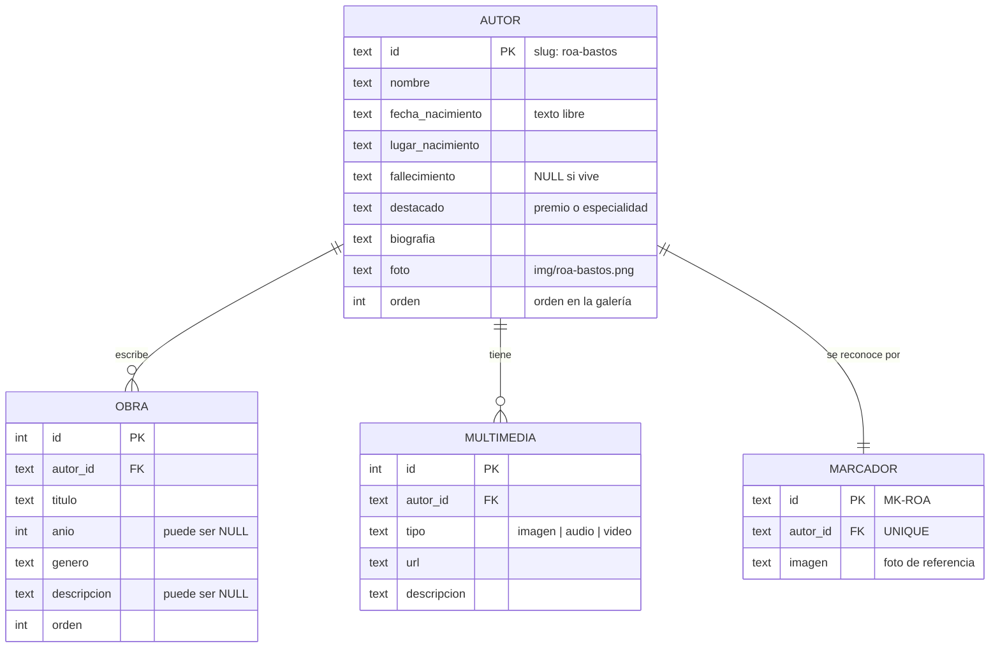

# Backend (Java)

Java 17, Maven, sin frameworks. Dependencias: `sqlite-jdbc` (base de datos), `org.openpnp:opencv` (OpenCV
4.9 para Java, con las librerías nativas incluidas), `slf4j-nop` (silencia los logs del driver) y JUnit 5 para
las pruebas. El `maven-shade-plugin` arma un único `target/librarium.jar` con todo
adentro, incluida la carpeta `web/`.

## Paquetes

```
py.librarium
├── Librarium              main: lee argumentos, inicializa la base, carga el reconocedor y levanta el servidor
├── ExportadorSitio        main alternativo: genera datos/*.json para GitHub Pages
├── conexion.ConexionBD    conexión JDBC a SQLite y ejecución de schema.sql / datos.sql
├── dao.AutorDAO           consultas de autores (con sus obras y multimedia)
├── dao.MarcadorDAO        consultas de marcadores (foto que reconoce el escáner)
├── modelo.*               records: Autor, Obra, Multimedia, Marcador
├── servicio.ReconocedorImagen   reconoce qué autor aparece en la imagen de la cámara (OpenCV)
├── controlador.ApiControlador   rutas /api/*
├── controlador.ArchivoControlador  sirve la página (archivos de web/)
├── controlador.Respuesta        helpers para responder JSON / texto
├── servidor.Servidor            HttpServer (8080) + HttpsServer (8443)
├── servidor.CertificadoSSL      genera y carga el certificado autofirmado
├── util.Json              serializa mapas, listas y records a JSON
├── util.Recursos          lee archivos de web/ desde el classpath (dentro del jar)
└── util.Red               detecta las IPs de la red local (para el celular)
```

El flujo de una petición es siempre: **controlador → DAO → ConexionBD → SQLite**, y la respuesta se arma con
los records de `modelo` convertidos por `util.Json`.

## Ejecución

```
java -jar target/librarium.jar [--puerto=8080] [--puerto-https=8443] [--sin-navegador]
```

| Argumento | Por defecto | Uso |
|---|---|---|
| `--puerto=N` | 8080 | Puerto HTTP (si 8080 está ocupado) |
| `--puerto-https=N` | 8443 | Puerto HTTPS para el celular |
| `--sin-navegador` | (abre el navegador) | No abrir el navegador al iniciar; lo usa Codespaces |

Si el puerto HTTP está en uso, el programa termina con un mensaje (`BindException`). Si no se puede iniciar
HTTPS (por ejemplo, porque falta `keytool`), sigue funcionando solo por HTTP y avisa en la consola.

## Base de datos

SQLite en el archivo `librarium.db`. El esquema está en
[`db/schema.sql`](../src/main/resources/db/schema.sql) y los datos en
[`db/datos.sql`](../src/main/resources/db/datos.sql).



Puntos importantes:

- **Los datos se cargan una sola vez.** `ConexionBD.inicializar()` siempre ejecuta `schema.sql`
  (`CREATE TABLE IF NOT EXISTS`), pero `datos.sql` solo si la tabla `autor` está vacía. **Si editás
  `datos.sql`, borrá `librarium.db`** para que se vuelva a cargar.
- Las claves foráneas tienen `ON DELETE CASCADE` y se activan con `PRAGMA foreign_keys = ON` en cada conexión.
- Las fechas se guardan como **texto libre** ("13 de junio de 1917") porque se muestran tal cual.
- El `id` del autor es un *slug* que se usa en las URLs (`#/autor/roa-bastos`) y en los nombres de archivo
  (`img/roa-bastos.png`, `modelos/roa-bastos.glb`). Conviene mantener esa coincidencia.
- `ConexionBD.separarSentencias()` divide los scripts por `;`, respetando los textos entre comillas simples
  e ignorando las líneas que empiezan con `--`. No soporta comentarios `/* */` ni `--` al final de una línea
  con código.
- Cada DAO abre y cierra su propia conexión por consulta (SQLite local, no hace falta pool).

## API REST

Base: `http://localhost:8080/api` (o `https://IP:8443/api`). Todas las respuestas son JSON en UTF-8 con
`Cache-Control: no-store`. No hay autenticación: la app es de solo lectura y se usa en una red local.

### `GET /api/autores`

Lista de autores ordenada por `orden` y `nombre`, cada uno con sus obras y su multimedia.

```json
[
  {
    "id": "roa-bastos",
    "nombre": "Augusto Roa Bastos",
    "fechaNacimiento": "13 de junio de 1917",
    "lugarNacimiento": "Asunción, Paraguay",
    "fallecimiento": "26 de abril de 2005, Asunción",
    "destacado": "Premio Cervantes 1989",
    "biografia": "Novelista y cuentista, es el escritor paraguayo más reconocido en el mundo. …",
    "foto": "img/roa-bastos.png",
    "obras": [
      { "titulo": "Yo el Supremo", "anio": 1974, "genero": "Novela", "descripcion": "Su obra maestra. …" }
    ],
    "multimedia": [
      { "tipo": "imagen", "url": "img/roa-bastos.png", "descripcion": "Retrato del autor" },
      { "tipo": "audio", "url": null, "descripcion": "Biografía leída con voz sintetizada" }
    ]
  }
]
```

Los nombres de los campos salen de los componentes de los records (`fechaNacimiento`, no `fecha_nacimiento`).
Los campos vacíos se mandan como `null`.

### `GET /api/autores/{id}`

Un autor con el mismo formato. `404 {"error": "Autor no encontrado"}` si no existe.

### `POST /api/reconocer`

Recibe en el cuerpo **la imagen cruda** (JPEG o PNG, máximo 2 MB) del recorte del marco verde de la cámara y
responde qué autor es.

```
POST /api/reconocer
Content-Type: image/jpeg

<bytes de la imagen>
```

```json
{ "coincide": true, "autorId": "roa-bastos", "puntaje": 1.0, "umbral": 0.5,
  "esquinas": [[0.112, 0.371], [0.651, 0.118], [0.893, 0.628], [0.347, 0.885]] }
```

| Campo | Significado |
|---|---|
| `coincide` | `true` si el mejor puntaje supera el umbral **y** le saca suficiente ventaja al segundo |
| `autorId` | El autor reconocido, o `null` si `coincide` es `false` |
| `puntaje` | Inliers del mejor autor / 30, máximo 1 (redondeado a 3 decimales). El frontend lo usa para la barra de progreso |
| `umbral` | `ReconocedorImagen.UMBRAL` (0.50, equivale a 15 inliers) |
| `esquinas` | Las 4 esquinas de la foto encontrada, `[x, y]` entre 0 y 1 dentro de la imagen enviada; `null` si no coincide |

Errores: `413` si la imagen pasa los 2 MB, `400` si no es una imagen válida.

### `GET /api/info`

Datos para que la página sepa cómo abrirse desde el celular (QR y avisos de HTTPS).

```json
{ "urlsCelular": ["https://192.168.0.15:8443"], "https": true, "puertoHttps": 8443 }
```

### Errores comunes a todas las rutas

| Código | Cuerpo |
|---|---|
| 404 | `{"error": "Ruta no encontrada"}` |
| 500 | `{"error": "Error interno del servidor"}` (el detalle se imprime en la consola del servidor) |

### Agregar un endpoint

1. Agregá la rama en `ApiControlador.handle()` (método + ruta).
2. Si necesita datos, agregá el método en el DAO correspondiente y devolvé records o `Map`.
3. Respondé con `Respuesta.json(ex, código, datos)`.
4. Si la página lo va a usar, agregá la función en `js/api.js` **y pensá qué hace en GitHub Pages**, donde no
   hay servidor (generar un JSON con `ExportadorSitio` o resolverlo en el navegador).

## Archivos estáticos

`ArchivoControlador` sirve cualquier archivo de `src/main/resources/web/` (empaquetado en el jar):

- `/` devuelve `index.html`.
- Rechaza rutas con `..` o `\` (para que no se pueda salir de la carpeta).
- El tipo MIME sale de la tabla `TIPOS` según la extensión. **Si agregás un tipo de archivo nuevo** (por
  ejemplo `.usdz` o `.mp4`), agregalo ahí; si no, se sirve como `application/octet-stream`.
- Responde con `Cache-Control: no-cache` para que los cambios se vean al recargar.

## HTTPS en la red local

Los navegadores del celular solo permiten usar la cámara en páginas seguras, por eso hay un segundo servidor
en el puerto 8443.

- `CertificadoSSL` genera `librarium-cert.p12` la primera vez llamando a `keytool` (viene con el JDK). El
  certificado es autofirmado, dura 10 años e incluye `localhost`, `127.0.0.1` y las IPs locales del momento.
- El celular muestra un aviso de seguridad la primera vez: hay que tocar **Avanzado → Continuar**.
- Si cambia la IP de la PC, el certificado sigue sirviendo (igual es autofirmado), pero se puede borrar
  `librarium-cert.p12` para regenerarlo con las IPs nuevas.
- `Red.ipsLocales()` ignora adaptadores virtuales (VirtualBox, WSL, Docker, VPN, etc.) para que el QR muestre
  la IP de la WiFi.

## ExportadorSitio (GitHub Pages)

`py.librarium.ExportadorSitio` crea una base temporal, la inicializa con `datos.sql` y escribe:

- `sitio/datos/autores.json`: lo mismo que `GET /api/autores`;
- `sitio/datos/marcadores.json`: la lista de marcadores, que usa `reconocedor.js` en el navegador.

Lo corre el workflow `.github/workflows/pages.yml`:

```
java -cp target/librarium.jar py.librarium.ExportadorSitio sitio
```

## Reconocimiento de imágenes

La explicación del algoritmo de `ReconocedorImagen` está en
[Realidad aumentada → Escáner de fichas](realidad-aumentada.md#escáner-de-fichas-impresas).

## Pruebas

```
mvnw test
```

| Prueba | Qué verifica |
|---|---|
| `ConexionBDTest` | Que el separador de SQL no corte textos con `;`, que los datos se carguen una sola vez, que haya 4 autores con 3 obras cada uno y 4 marcadores |
| `ReconocedorImagenTest` | Con OpenCV: que reconozca cada ficha impresa (color, blanco y negro, girada 25°, inclinada en perspectiva, foto grande), que devuelva esquinas dentro de la imagen y que **no** reconozca una hoja en blanco, una cara cualquiera ni bytes que no son imagen |
| `JsonTest` | Serialización de records, mapas, listas y caracteres especiales |

> Las pruebas tienen **valores fijos** (4 autores, 3 obras, la lista de ids). Si agregás un autor, actualizalas.

## OpenCV en Java

- `ReconocedorImagen` carga la librería nativa con `nu.pattern.OpenCV.loadLocally()` en un bloque `static`:
  la extrae del jar a una carpeta temporal la primera vez.
- El jar pesa ~100 MB porque trae OpenCV para Windows, Linux y macOS (64 bits). El `maven-shade-plugin`
  excluye Windows de 32 bits y ARMv7.
- Los `Mat` de OpenCV usan memoria nativa que el recolector de Java no ve: el código los libera con
  `release()` en bloques `finally`. Si agregás código con OpenCV, hacé lo mismo.
- `ORB` y `BFMatcher` se crean en cada análisis porque no son seguros entre hilos (el servidor atiende con 16).

El workflow de GitHub Pages corre las pruebas antes de publicar: si una falla, **no se publica**.
