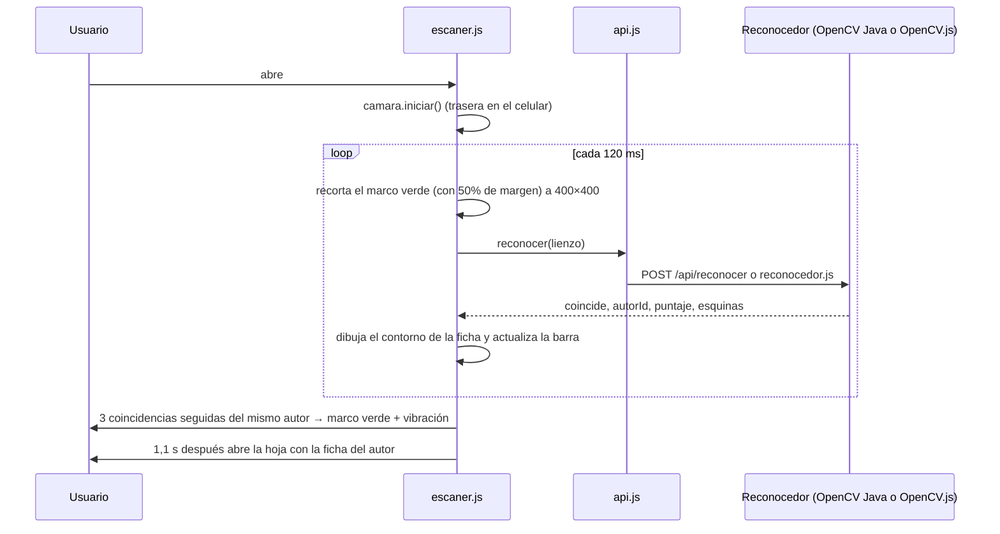

# Realidad aumentada, modelos 3D y escáner

Librarium tiene dos funciones que usan la cámara y conviene no confundir:

| | Realidad aumentada 3D (`#/ra`) | Escáner de fichas (`#/escanear`) |
|---|---|---|
| Qué hace | Coloca una escultura 3D del autor en el espacio real | Reconoce la foto impresa de un autor y abre su ficha |
| Tecnología | `<model-viewer>` de Google (WebXR / Scene Viewer / Quick Look) | OpenCV (ORB + BFMatcher + homografía), en Java o en el navegador |
| Código | `js/ra3d.js`, `web/modelos/*.glb`, `herramientas/` | `js/escaner.js`, `js/camara.js`, `ReconocedorImagen.java`, `js/reconocedor.js` |

El escáner funciona como **disparador**: cuando reconoce una ficha, la hoja del autor tiene el botón
**Ver en Realidad Aumentada**, que lleva a `#/ra/{id}`.

---

## Realidad aumentada 3D

### Cómo funciona

La vista usa el componente [`<model-viewer>`](https://modelviewer.dev) (el mismo tipo de RA que los "animales
3D" del buscador de Google). En `index.html`:

```html
<model-viewer id="visor-ra" ar ar-modes="webxr scene-viewer quick-look" ar-placement="floor" ar-scale="auto"
              camera-controls touch-action="pan-y" camera-orbit="0deg 80deg auto"
              shadow-intensity="1" environment-image="neutral">
  <div slot="hotspot-nombre" data-position="-0.15 1.72 0" data-normal="0 0 1">…nombre…</div>
  <button slot="ar-button">Ver en tu espacio</button>
</model-viewer>
```

| Atributo | Para qué |
|---|---|
| `ar-modes="webxr scene-viewer quick-look"` | Orden de preferencia: WebXR (Chrome en Android, RA dentro de la página), Scene Viewer (app de Google en Android), Quick Look (Safari en iPhone/iPad) |
| `ar-placement="floor"` | La escultura se apoya en el piso |
| `ar-scale="auto"` | Tamaño real, pero el usuario puede agrandarla o achicarla con dos dedos |
| `camera-controls` | Girar y hacer zoom en la vista 3D de la página |
| `slot="hotspot-nombre"` | Etiqueta con el nombre flotando arriba del busto (se ve en la página y en WebXR; Scene Viewer y Quick Look no muestran hotspots) |
| `slot="ar-button"` | Botón propio; `<model-viewer>` lo oculta solo si el dispositivo no soporta RA |

`ra3d.js` muestra el aviso "abrí esta página desde un celular" cuando `visor.canActivateAR` es `false`
(por ejemplo, en una PC).

### Requisitos para que aparezca "Ver en tu espacio"

- **HTTPS** (GitHub Pages ya lo es; con el servidor Java, usar el puerto 8443).
- **Android:** Chrome y un celular compatible con ARCore ("Servicios de Google Play para RA").
- **iPhone/iPad:** Safari con iOS 12 o posterior. `<model-viewer>` convierte el modelo a USDZ en el momento.

### El modelo 3D de cada autor

Cada `web/modelos/{autor}.glb` es una escena de museo en **tamaño real** (metros, eje Y hacia arriba, el frente
mirando a +Z), de unos **2,9 m de ancho y 1,7 m de alto**:

```
   [Panel BIOGRAFÍA]        busto / retrato   libros        [Panel OBRAS]
     girado 22° →        ┌──────────────────────┐          ← girado 22°
                         │  placa con el nombre │
                         └──────────────────────┘
                               pedestal
```

| Parte | Detalle |
|---|---|
| Pedestal | 1,1 × 0,9 × 0,46 m, azul marino con borde esmeralda (los colores de la app) |
| Placa | Textura dorada con el nombre del autor |
| Autor | **Busto de bronce** si existe `herramientas/bustos/{autor}.glb`; si no, **retrato enmarcado** con la foto |
| Libros | Tres libros apilados (decoración) |
| Panel izquierdo | Textura con nombre, insignia, nacimiento, fallecimiento y biografía |
| Panel derecho | Textura con cada obra: título, género, año y descripción |

Los textos de los paneles son **imágenes dentro del modelo** (no HTML), por eso se ven en todos los modos de
RA, incluidos Scene Viewer y Quick Look. Tienen un poco de brillo propio (`emissive`) para que se lean aunque
haya poca luz.

Peso aproximado: ~470 KB con retrato, ~1,2 MB con busto.

### Generar los modelos: `herramientas/generar_modelos.py`

```
pip install pillow
python herramientas/generar_modelos.py
```

Salida esperada:

```
src\main\resources\web\modelos\roa-bastos.glb (1240 KB, busto)
src\main\resources\web\modelos\delfina-acosta.glb (480 KB, retrato)
…
```

Qué hace, en orden:

1. **Lee los datos** ejecutando `schema.sql` y `datos.sql` en una base SQLite en memoria (con el módulo
   `sqlite3` de Python). Así los paneles siempre muestran lo mismo que la app.
2. **Dibuja las texturas** con Pillow: los dos paneles (1024 × 1400 px) y la placa. La letra empieza grande y
   se achica sola hasta que el texto entra. Usa Georgia y Segoe UI en Windows, DejaVu en Linux, o la fuente
   por defecto de Pillow.
3. **Arma la escena glTF a mano** (clase `Modelo`): cubos escalados para pedestal, marco, patas y libros;
   planos con textura para paneles, placa y retrato; y la malla del busto si existe.
4. **Escribe el `.glb`** (formato binario de glTF 2.0) sin librerías externas.

Hay que volver a correrlo cuando cambia:

- la biografía, las obras o cualquier dato en `datos.sql`;
- una foto en `web/img/`;
- un busto en `herramientas/bustos/`;
- el diseño de la escultura (el propio script).

Para comprobar que un modelo es válido:
[glTF Validator](https://github.khronos.org/glTF-Validator/) (arrastrás el `.glb`) o
`https://modelviewer.dev/editor/` para verlo.

### Bustos hechos con IA

Los bustos de `herramientas/bustos/` se generaron a partir de la foto de cada autor con
[Hunyuan3D-2.1](https://huggingface.co/spaces/tencent/Hunyuan3D-2.1) (IA de Tencent que convierte una foto en
un modelo 3D), usando solo la **forma** (sin textura). El script los pinta de bronce.

| Autor | Estado |
|---|---|
| Augusto Roa Bastos | Busto listo |
| Josefina Plá | Busto listo |
| Delfina Acosta | Pendiente: la IA no separó la persona del fondo (salió un cubo). Hay que pasarle la foto ya recortada |
| Mauricio Cardozo Ocampo | Pendiente: la foto es en blanco y negro con pelo y traje negros sobre fondo negro; la IA lo hizo plano |

**Cómo hacer un busto nuevo:**

1. Entrar a https://huggingface.co/spaces/tencent/Hunyuan3D-2.1, subir la foto del autor y generar **solo la
   forma** (sin textura; desde código es el endpoint `/shape_generation` con `gradio_client`). Funciona mejor
   con la persona sola, de frente y con buena luz. Si la IA no la separa bien del fondo, recortarla antes (por
   ejemplo con [rembg](https://github.com/danielgatis/rembg) o cualquier herramienta de quitar fondo) y
   desactivar la opción de quitar el fondo del espacio.
2. Descargar el `.glb`. Sale con unos 400 mil triángulos (~7 MB), demasiado para un celular.
3. Simplificarlo a ~50 mil triángulos:

   ```
   npx @gltf-transform/cli weld crudo.glb soldado.glb
   npx @gltf-transform/cli simplify soldado.glb herramientas/bustos/<autor>.glb --ratio 0.12 --error 0.0008
   ```

   El nombre del archivo tiene que ser el de la foto (`img/roa-bastos.png` → `bustos/roa-bastos.glb`).
4. Correr `python herramientas/generar_modelos.py`.

El script toma el busto, lo centra, lo apoya sobre el pedestal y lo escala para que entre en un espacio de
0,72 m de ancho × 0,78 m de alto × 0,45 m de fondo. Espera una sola malla sin texturas, mirando a +Z.

> Hugging Face da poca GPU gratis sin cuenta (unos minutos por día). Con una cuenta gratuita y un token
> (`HF_TOKEN`) la cuota es mayor. También se puede usar otro servicio de foto a 3D (Meshy, Tripo, etc.)
> siempre que se exporte `.glb`.

---

## Escáner de fichas impresas

El reconocimiento usa **OpenCV**: [OpenCV para Java](https://github.com/openpnp/opencv) (`org.openpnp:opencv`
4.9.0) en el servidor y [OpenCV.js](https://www.npmjs.com/package/@techstark/opencv-js) 4.10 en el navegador
cuando la app está en GitHub Pages. Es la técnica clásica de reconocimiento de imágenes planas: puntos clave ORB
+ emparejamiento + homografía.

### Flujo



Constantes en `escaner.js`:

| Constante | Valor | Significado |
|---|---|---|
| `INTERVALO_MS` | 120 | Tiempo entre análisis |
| `CUADROS_PARA_CONFIRMAR` | 3 | Coincidencias seguidas necesarias (evita falsos positivos) |
| `LADO_RECORTE` | 400 | Tamaño del recorte que se analiza (OpenCV necesita detalle para encontrar puntos clave) |
| `MARGEN_RECORTE` | 1.5 | Se manda un poco más que el marco, por si la foto está corrida o es más grande |
| `ESPERA_FICHA_MS` | 1100 | Pausa para mostrar el "reconocido" antes de abrir la ficha |

Cuando OpenCV encuentra la ficha, devuelve sus **cuatro esquinas** y `escaner.js` dibuja un contorno verde
encima del video (`<svg id="ra-contorno">`), que sigue a la ficha aunque esté girada o inclinada.

La cámara se apaga al salir de la vista, al cambiar de pestaña o al bloquear el celular, y se vuelve a prender
al volver. En GitHub Pages, la primera vez se descarga OpenCV.js (~10 MB) y el estado muestra
"Cargando OpenCV…".

### Algoritmo (`ReconocedorImagen.java` ≡ `reconocedor.js`)

Al iniciar, por cada foto de referencia (tabla `marcador`) se calculan sus **puntos clave ORB** y sus
descriptores. Para cada imagen de la cámara:

1. **Escala de grises**, achicada a 480 px como máximo.
2. **ORB** (`ORB.create(1000)`): busca hasta 1000 puntos clave (esquinas y detalles) y calcula un descriptor
   binario de cada uno. ORB no cambia si la imagen está girada o a otra escala.
3. **Emparejar** contra cada autor con `BFMatcher` (fuerza bruta, distancia de Hamming) y `knnMatch` de 2
   vecinos. **Prueba de Lowe**: un par se acepta solo si el mejor vecino es claramente mejor que el segundo
   (distancia < 0,75 × la del segundo).
4. **Verificación geométrica** con `findHomography` + RANSAC (error de 5 px): de todos los pares, se quedan los
   que encajan como una misma foto plana vista desde la cámara (los *inliers*). Se descartan homografías
   absurdas: el contorno proyectado tiene que ser convexo y ocupar al menos el 1% de la imagen.
5. **Decidir**: `puntaje = inliers / 30` (máximo 1). Coincide si el puntaje es ≥ `UMBRAL` (0,50, o sea
   **15 inliers**) **y** el ganador tiene al menos el **doble** de inliers que el segundo autor.
6. Las **esquinas** de la foto se proyectan con `perspectiveTransform` y se devuelven entre 0 y 1.

Márgenes medidos con las fichas de prueba: el autor correcto obtiene entre 30 y 600 inliers (foto chica,
grande, girada 25°, en blanco y negro u oscura) y el segundo nunca más de 6. Cada análisis tarda 10 a 50 ms
en el servidor y 20 a 80 ms con OpenCV.js.

Para que funcione bien: buena luz, sin reflejos y la ficha quieta dentro del marco. Las fotos con mucho
detalle (pelo, ropa, fondos con textura) dan más puntos clave.

> Si cambiás una constante o un paso, cambialo **en los dos archivos**. El de Java se usa con el servidor y
> el de JavaScript en GitHub Pages. `ReconocedorImagenTest` prueba el de Java.

> **OpenCV.js y `then()`:** el módulo de OpenCV.js tiene un método `then()`. Si se pasa a `resolve()` de una
> promesa, la promesa se queda esperándolo para siempre. Por eso `cargarOpenCV()` guarda el módulo en una
> variable y resuelve sin valor.
